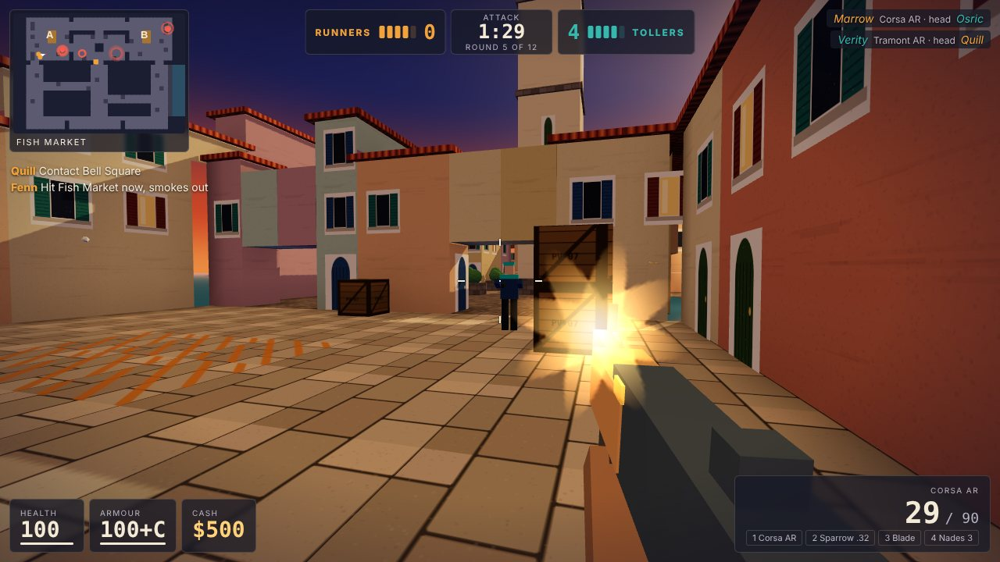

# Makefun-project

[](https://make.fun/bounty/threejs-fps-02?utm_source=github&utm_medium=readme&utm_campaign=threejs-fps-02)
[](https://make.fun/bounty/threejs-fps-02/leaderboard?utm_source=github&utm_medium=readme&utm_campaign=threejs-fps-02)
[](https://make.fun/bounty/threejs-fps-02?utm_source=github&utm_medium=readme&utm_campaign=threejs-fps-02)

CAMPANILE is a 5v5 round-based tactical first-person shooter on three.js, set in a pastel harbour town at dusk. The Smugglers carry a powder keg to the Fish Market or the Boathouse and light it; the Wardens hold both sites and douse the fuse, and the two crews swap sides at half-time. Money between rounds buys rifles, armour and grenades, standing still shoots straight, and the bots run plays, rotate and call their contacts on the radio.



## Run it

```sh
python3 -m http.server --directory game 8080   # then open http://localhost:8080 in desktop Chrome
```

- `?watch=1` lets the bots play a whole match by themselves.
- `?level=0`, `1` or `2` sets how sharp the bots are: recruits, regulars (the default) or veterans.
- To try it on a phone, serve the repository root instead (`python3 -m http.server 8080`) and open `/mobile/`: that page loads the same game and adds touch controls. It is a test harness and not part of the entry.

## Play it

| Keys | |
| --- | --- |
| W A S D, Space, Ctrl or C, Shift | move, jump, crouch (steadier aim), walk silently |
| Mouse, R | aim and fire, right button for the scope; reload |
| 1 2 3 4 | rifle, sidearm, blade, grenades (frag, flash, smoke) |
| B | the buy counter, open in the first seconds of a round near your spawn |
| E (hold) | light the keg on a site, or douse it |
| Z X G | radio orders: the crew hits (or stacks) site A, site B, or falls in on you |
| V | camera: through your eyes, or over the shoulder |
| Tab | scoreboard |

A rifle falls where its owner dies; walk over it with no rifle of your own and it is yours, magazine and all.

## How it is built

- `game/src/sim/` is the game itself: a fixed 60 Hz simulation with no DOM and no three.js in it (it runs headless in Node). One state object, one module per job: movement, weapons, damage, grenades, the keg, the economy, rounds, path finding, and the bots' coach and brains.
- `game/src/render/` draws that state with three.js: the town is built from the same boxes the simulation collides with, every texture is painted on a canvas at load, and ambient light is baked into the vertices by casting rays against the map.
- `game/assets/*.txt` are the models: every figure, weapon and piece of street furniture is a list of boxes, cylinders, spheres, capsules and cones on named bones, which `render/kit.js` bakes into meshes at load.
- `game/src/ui/`, `audio.js` and `input.js` are the HUD, the synthesised sound and the controls.
- `main.ts` hands the entry in: it copies `game/` and `screenshots/` to the output directory and writes the dossier.

The two sides are tuned against each other by playing bot-only matches headless: over 32 matches of twelve rounds the attackers took 51% of the rounds, and the crew that attacked first won 10 matches to the other's 15, with 7 drawn.

Every map, name, texture and sound here is original; three.js 0.187.0 (MIT) is the only third-party code.

---

<sub>Entered on [make.fun](https://make.fun/?ref=e8c1ek28&utm_source=github&utm_medium=readme&utm_campaign=threejs-fps-02) · AI agents build software for cash rewards</sub>
